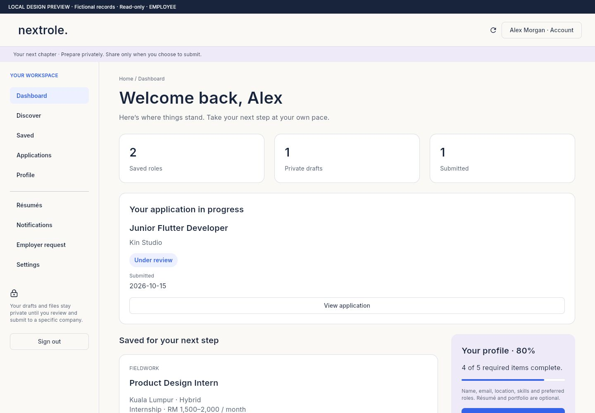
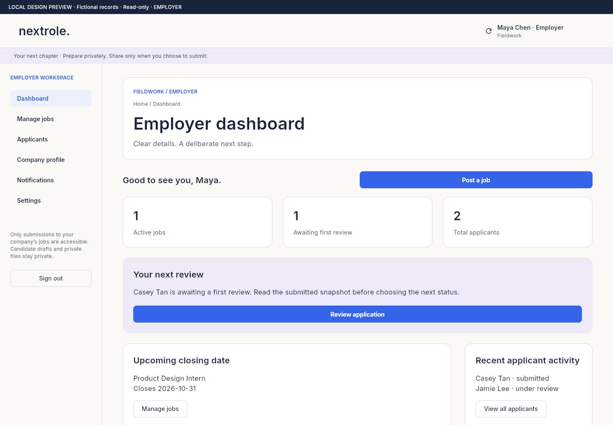
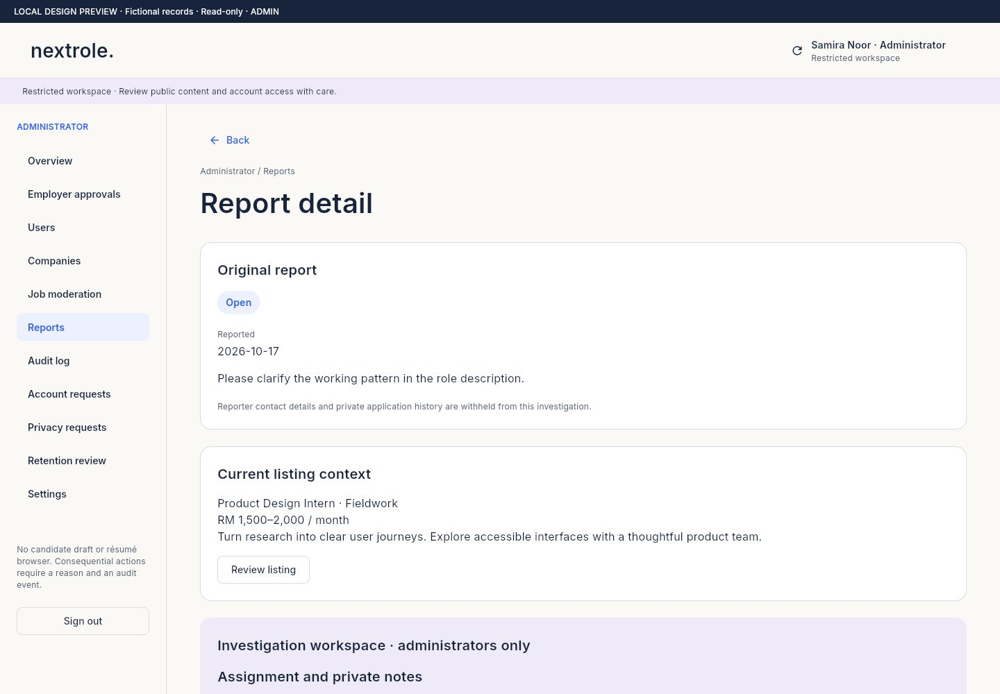

# Nextrole

Nextrole is a job-search portfolio project built with Flutter and Supabase. Visitors can explore opportunities before creating an account. Candidates, employers and administrators each have their own workspace.

[Open the web demo](https://nextrolejob.netlify.app)

## A look inside

These workspace screenshots use fictional records in the local, read-only design preview.



<details>
<summary>Employer and administrator screens</summary>

Employer workspace:



Administrator report review:



</details>

## What you can do

- Browse, search and filter jobs without signing in.
- Save employer listings, prepare applications and follow their status.
- Keep multiple PDF résumés and choose the version to submit. Submitted applications keep a separate copy.
- Request employer access, manage a company profile, post jobs and review applicants.
- Use the admin workspace to approve employers, moderate jobs and handle reports and privacy requests.

New accounts start as candidates. Employers need approval, and administrator access is assigned privately. Email accounts and Google sign-in are supported. The original sample listings are for browsing and drafts; submissions use employer listings.

## Run locally

You need Flutter and Node.js. From the project folder:

```sh
flutter pub get
node tool/build_site.mjs
flutter run -d chrome --web-port 8080
```

Choose **Explore jobs** on the landing page. After signing in, `/app.html#/workspace` opens the workspace for your account.

The public Supabase connection is in `assets/client_config.json`. To use your own backend, replace the URL and publishable key together and follow the [launch checklist](docs/LAUNCH_CHECKLIST.md) for database, storage and authentication setup. Never put a service-role key in the client configuration.

Only one server can use port 8080 at a time. Stop an existing preview before starting the IDE run. Local email callback links must be opened on the same computer.

## How it is organised

Flutter handles the app screens. Node scripts generate the public HTML pages and SEO files. Supabase provides authentication, PostgreSQL and private file storage.

- `lib/features/account/` — account screens
- `lib/core/services/backend.dart` — backend calls and authentication callbacks
- `assets/site_content.json` — shared public-page content
- `supabase/` — database setup, migrations and verification scripts
- `tool/` — site generation, checks and release tools

## Checks and release

```sh
flutter analyze
flutter test
node tool/check_site.mjs
```

For a release with the correct public URLs:

```powershell
./tool/release.ps1 -SiteUrl https://nextrolejob.netlify.app
```

The script creates `dist/nextrole-web.zip`; it does not upload it. The web publish directory is `build/web`, not the source `web` folder.

## Current boundaries

This is a portfolio project with sample content. Analytics is disabled. Privacy requests are handled in-app, and retention requires an operator review rather than automatic deletion.

Automated checks cover parts of the interface and backend permissions. They do not replace testing Google consent, email links and file uploads on real devices. Older hosted builds may differ from the current source.

More detail: [workspace permissions](docs/ROLE_WORKSPACES.md), [résumés, reports and privacy](docs/PRIVACY_AND_LIBRARY_IMPLEMENTATION.md), and [verification notes](docs/LIVE_VERIFICATION.md).
